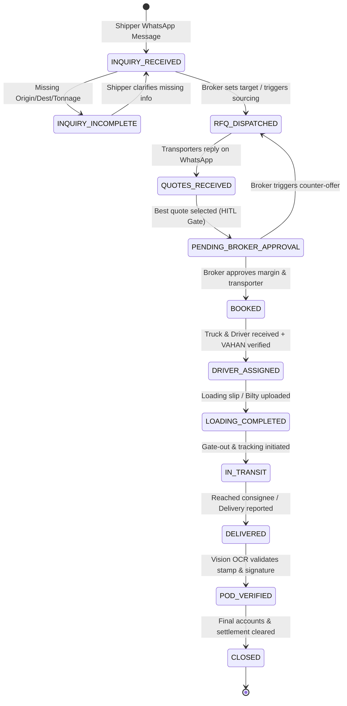
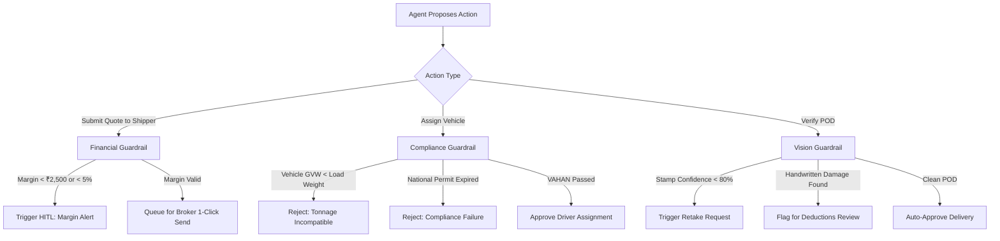

# System Design & Architecture Specification
## Project: Indian Freight Broker AI Operations Harness

---

## 1. High-Level Architecture (HLA)

The system is architected as an **Event-Driven Agent Harness** wrapping multi-modal foundation models. Deterministic components (State Machine, Financial Guardrails, VAHAN Validator, HITL Queue) govern all probabilistic outputs (LLM extractions, drafts, summaries) before state mutations or external messaging occur.

```
                  ┌─────────────────────────────────────────────────────────────┐
                  │                 INBOUND CHANNELS & ADAPTERS                 │
                  │  • WhatsApp Webhook (Meta Cloud API / Twilio)               │
                  │  • Vision Document Ingestion (Bilty / LR, POD photos)       │
                  │  • Broker Web Console (FastAPI REST & WebSockets)           │
                  └──────────────────────────────┬──────────────────────────────┘
                                                 │
                                                 ▼
┌───────────────────────────────────────────────────────────────────────────────────────────┐
│                                FREIGHT AGENT HARNESS CORE                                 │
│                                                                                           │
│   ┌───────────────────────────┐                 ┌─────────────────────────────────────┐   │
│   │ 1. Event Ingestion Engine │                 │ 2. Domain State Machine (FSM)       │   │
│   │ • Message Normalizer      │────────────────►│ • Life-of-a-Load Transitions        │   │
│   │ • Multimodal Preprocessor │                 │ • Invariant Enforcement             │   │
│   └───────────────────────────┘                 └──────────────────┬──────────────────┘   │
│                 │                                                  │                      │
│                 ▼                                                  ▼                      │
│   ┌───────────────────────────┐                 ┌─────────────────────────────────────┐   │
│   │ 3. Specialized AI Agents  │                 │ 4. Deterministic Guardrails Engine  │   │
│   │ • Load Intake Agent       │◄───────────────►│ • Margin Floor Policy               │   │
│   │ • Transporter RFQ Agent   │                 │ • VAHAN / RTO Compliance Gate       │   │
│   │ • POD Vision Agent        │                 │ • Tonnage & Vehicle Compatibility   │   │
│   └───────────────────────────┘                 └──────────────────┬──────────────────┘   │
│                                                                    │                      │
│                                                                    ▼                      │
│                                                 ┌─────────────────────────────────────┐   │
│                                                 │ 5. HITL Action Queue & Dispatcher   │   │
│                                                 │ • High-Risk Actions (Needs Approval)│   │
│                                                 │ • Low-Risk Actions (Auto-Dispatch)  │   │
│                                                 └──────────────────┬──────────────────┘   │
└────────────────────────────────────────────────────────────────────┼──────────────────────┘
                                                                     │
                                    ┌────────────────────────────────┴──────────────────┐
                                    ▼                                                   ▼
                     ┌─────────────────────────────┐                     ┌─────────────────────────────┐
                     │    POSTGRESQL / PERSISTENCE │                     │    OUTBOUND ADAPTERS        │
                     │ • Multi-tenant isolation    │                     │ • WhatsApp Cloud API        │
                     │ • Immutable Audit Log       │                     │ • Realtime WebSocket to UI  │
                     │ • Lane Rate History         │                     │ • VAHAN / Fastag Mock/Live  │
                     └─────────────────────────────┘                     └─────────────────────────────┘
```

---

## 2. Domain State Machine (FSM)

A shipment must transition through explicit states. Probabilistic LLMs cannot jump or skip states.



### State Transition Validation Rules (Invariants)
| Source State | Event / Trigger | Target State | Guardrail Invariant |
| :--- | :--- | :--- | :--- |
| `INQUIRY_RECEIVED` | `DISPATCH_RFQ` | `RFQ_DISPATCHED` | Must have Origin, Destination, Weight, Vehicle Type, Target Pickup Date. |
| `QUOTES_RECEIVED` | `SELECT_QUOTE` | `PENDING_BROKER_APPROVAL` | Quote must be parsed into numeric INR; Transporter contact must be active. |
| `PENDING_BROKER_APPROVAL` | `APPROVE_BOOKING` | `BOOKED` | **Human-in-the-Loop strictly required.** Net Margin must be $\ge$ configured floor unless explicit manual override. |
| `BOOKED` | `SUBMIT_VEHICLE` | `DRIVER_ASSIGNED` | Vehicle Reg Number must pass format check; VAHAN fitness & permit must be valid. |
| `IN_TRANSIT` | `RECORD_DELIVERY`| `DELIVERED` | Time elapsed must be plausible based on route distance (e.g., cannot deliver 1,000 km in 2 hours). |
| `DELIVERED` | `VERIFY_POD` | `POD_VERIFIED` | Stamp confidence $>0.80$; No unresolved handwritten damage/shortage annotations. |

---

## 3. Core Domain Data Contracts (Pydantic Schemas)

### 3.1 Vehicle Classification Taxonomy
```python
from enum import Enum

class VehicleCategory(str, Enum):
    LCV_SMALL = "LCV_SMALL"        # Tata Ace / Bolero Pickup (1.0 - 2.5T)
    ICV = "ICV"                    # 14ft - 19ft (4.0 - 7.0T)
    MCV_6W = "MCV_6W"              # 6-Wheeler (9.0 - 10.0T)
    HCV_10W_TAURUS = "HCV_10W"    # 10-Wheeler Taurus (16.0 - 18.0T)
    HCV_MULTI_AXLE = "HCV_MULTI"   # 12 / 14-Wheeler (21.0 - 28.0T)
    CONTAINER_32_SXL = "32_SXL"    # 32ft Single Axle (7.5T)
    CONTAINER_32_MXL = "32_MXL"    # 32ft Multi Axle (14.0 - 18.0T)
    CONTAINER_32_HQ = "32_HQ"      # 32ft High Cube (Volumetric)
    CONTAINER_40_HQ = "40_HQ"      # 40ft High Cube
```

### 3.2 Load Entity
```python
from pydantic import BaseModel, Field
from typing import Optional, List
from datetime import datetime

class Load(BaseModel):
    id: str
    tenant_id: str                      # Broker company isolation
    shipper_name: str
    shipper_phone: str
    origin_city: str
    origin_hub: Optional[str] = None    # e.g., "Peenya Industrial Area"
    destination_city: str
    destination_hub: Optional[str] = None # e.g., "Bhiwandi Warehouse"
    material_type: str                  # e.g., "Pharma", "FMCG", "Auto Parts"
    weight_tonnes: float
    vehicle_required: VehicleCategory
    target_pickup_date: datetime
    shipper_target_rate: Optional[float] = None  # Customer agreed price in INR
    status: str                         # FSM state
    created_at: datetime
    updated_at: datetime
```

### 3.3 Transporter & Quote Entities
```python
class Transporter(BaseModel):
    id: str
    tenant_id: str
    business_name: str
    contact_name: str
    phone_number: str
    preferred_lanes: List[str]          # e.g., ["BLR-BHW", "BLR-HYD"]
    reliability_score: float = 5.0      # Scale 1-5 based on past on-time delivery
    is_verified: bool = True

class Quote(BaseModel):
    id: str
    load_id: str
    transporter_id: str
    quoted_amount: float                # Base freight in INR
    includes_tolls: bool = True
    loading_unloading_charges: float = 0.0
    validity_hours: int = 12
    raw_message: str                    # Original WhatsApp voice transcription / text
    confidence_score: float             # Parsing confidence from LLM
    is_selected: bool = False
    created_at: datetime
```

### 3.4 Trip & Vehicle Compliance
```python
class VehicleCompliance(BaseModel):
    vehicle_number: str                 # e.g., "KA 04 AB 1234"
    is_vahan_verified: bool
    rc_status: str                      # "ACTIVE"
    fitness_valid_upto: datetime
    national_permit_valid: bool
    insurance_valid_upto: datetime
    registered_gvw_kg: int              # Gross Vehicle Weight

class Trip(BaseModel):
    id: str
    load_id: str
    transporter_id: str
    agreed_transporter_rate: float
    customer_rate: float
    gross_margin: float
    margin_percentage: float
    advance_payable: float              # 70-80% on loading
    balance_payable: float
    driver_name: str
    driver_phone: str
    vehicle_number: str
    compliance: VehicleCompliance
    status: str
```

### 3.5 Action Queue Item (HITL Contract)
```python
class ActionPriority(str, Enum):
    URGENT = "URGENT"       # Blocks shipment / Margin issue
    NORMAL = "NORMAL"       # Routine booking confirmation
    INFO = "INFO"           # Status notification

class ActionItem(BaseModel):
    id: str
    tenant_id: str
    load_id: str
    priority: ActionPriority
    title: str
    description: str
    proposed_action: str                # e.g., "CONFIRM_BOOKING_TRANSPORTER_B"
    data_payload: dict                  # Context for decision (rates, margins)
    options: List[str]                  # ["Approve", "Counter with 44k", "Reject"]
    status: str                         # "PENDING", "APPROVED", "REJECTED"
    created_at: datetime
```

---

## 4. Deterministic Guardrails Engine

The Guardrails Engine acts as a gatekeeper between AI reasoning and real-world execution.



### 4.1 Financial Margin Policy Formula
```python
def evaluate_margin(customer_rate: float, transporter_quote: float, estimated_accessorials: float = 0.0) -> dict:
    gross_margin = customer_rate - (transporter_quote + estimated_accessorials)
    margin_pct = (gross_margin / customer_rate) * 100 if customer_rate > 0 else 0.0
    
    # Policy: Minimum ₹2,500 absolute OR minimum 5.0%
    is_safe = gross_margin >= 2500.0 and margin_pct >= 5.0
    
    return {
        "gross_margin": gross_margin,
        "margin_percentage": round(margin_pct, 2),
        "is_safe": is_safe,
        "requires_override": not is_safe
    }
```

---

## 5. Security, Isolation & Multi-Tenancy

Freight brokerage is a fierce relationship and privacy business. A broker will abandon the software if they suspect another broker or platform can see their clients, rates, or margins.

1. **Strict Tenant Scoping:** Every SQL table and Redis key includes a `tenant_id`. Every DB query enforces `WHERE tenant_id = :current_tenant`.
2. **Encrypted Transporter Ledgers:** Transporter phone numbers and contact lists are AES-256 encrypted at rest.
3. **No Cross-Tenant Training:** No broker's proprietary rate negotiations or customer lists are ever fed back into shared training sets or public models.
4. **Audit Trail:** Every rate alteration, quote acceptance, and driver assignment is permanently logged with timestamp and user ID.
